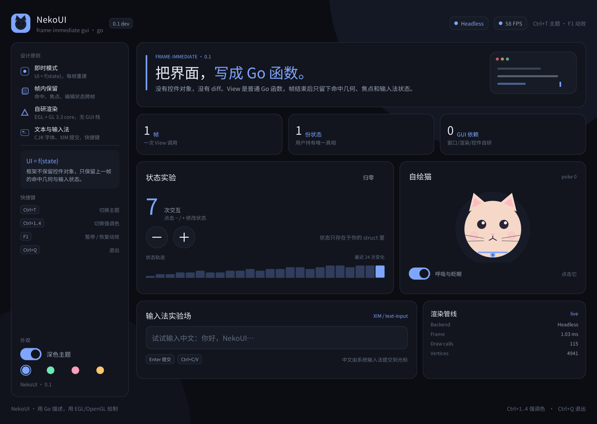
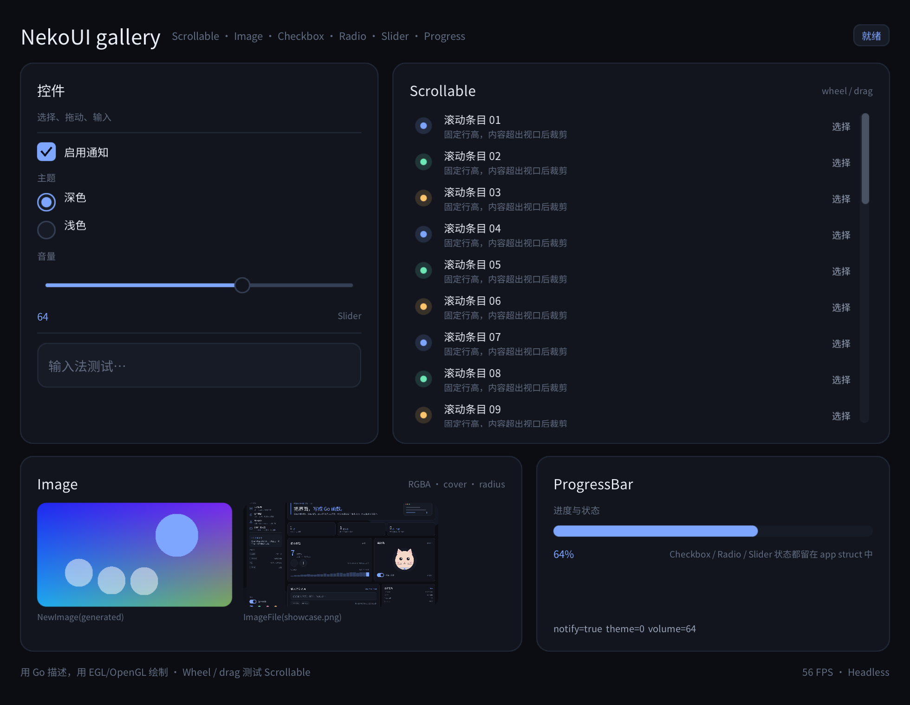

# NekoUI

> 把界面，写成 Go 函数。

NekoUI 是一个从零实现的 Go 即时模式 GUI 框架：自研窗口层、OpenGL 3.3 渲染器、布局/焦点/输入法桥接和自绘控件。它不依赖 GLFW、SDL、Qt、Fyne 或 Gio，底层只使用系统 ABI（Xlib / libwayland-client / EGL / OpenGL / xkbcommon）。





## 当前状态

M1（X11 垂直切片）与 M2（Wayland 后端）已跑通；M3/M4 的输入法与高级控件已经落地一部分。

| 能力 | 状态 |
| --- | --- |
| X11 窗口 / 事件 / 光标 / DPI | ✅ 可用 |
| Wayland 窗口 / EGL / xkb / 指针 / 缩放 | ✅ 已实现（KWin 实测） |
| EGL + OpenGL 3.3 core 渲染 | ✅ 可用 |
| 自绘 Canvas、圆角矩形、线条、多边形、文本、图片 | ✅ 可用 |
| 即时模式 API、帧内命中、焦点、Tab 导航 | ✅ 可用 |
| 单行文本编辑、拖拽选择、双击选词、应用内剪贴板 | ✅ 可用 |
| 快捷键（含输入框聚焦时） | ✅ 可用 |
| CJK 字体与字体图集 | ✅ Noto Sans CJK SC |
| X11 XIM 输入法 | ✅ 自动探测 fcitx/ibus，候选窗跟随 caret |
| Wayland text-input-v3 | ✅ enable / commit / preedit / delete-surrounding |
| 高级控件 | ✅ Scrollable、Image、Checkbox、Radio、Slider、ProgressBar |
| 无头 EGL 截图 | ✅ 可用 |
| 系统剪贴板、X11 行内 preedit | 🚧 计划中 |

**边界说明：** NekoUI 的“窗口管理器”指的是客户端侧的窗口/事件/输入法/渲染抽象，不是 X11/Wayland compositor。我们不重写显示服务器协议，只把系统 ABI 封装在可替换的 backend 后面。

## 快速开始

要求：Linux、Go 1.27+、CGO 开启、X11 + EGL + OpenGL（或 Wayland + libwayland-client/egl/cursor + libxkbcommon）运行时，以及一个系统 CJK 字体。Wayland 协议绑定已生成并随仓库提交，构建时不需要 `wayland-scanner` 或开发包。

```bash
# 交互式运行：Wayland 会话默认 Wayland，否则 X11
go run ./examples/showcase

# 高级控件画廊
go run ./examples/gallery

# 输入法诊断（自动聚焦输入框）
go run ./examples/ime -backend x11

# 无头渲染一张 2x 截图
go run ./examples/showcase -screenshot /tmp/nekoui.png

# 强制后端 / 指定缩放
go run ./examples/showcase -backend x11 -scale 1
```

环境变量：

- `NEKOUI_BACKEND=x11|wayland|headless` 强制后端（等价于 `-backend`）
- `NEKOUI_FONT=/path/to/font.ttf|ttc` 覆盖字体
- `NEKOUI_SCALE=1.5` 覆盖 DPI 缩放（截图模式默认 2）
- `NEKOUI_DEBUG=1` 输出后端、GL、字体、焦点/输入法定位和归一化事件日志
- `NEKOUI_DEBUG_OPS=1` 每帧打印前 25 条 display-list 指令

> X11 输入法：如果会话没有导出 `XMODIFIERS`，NekoUI 会从 root 的 `XIM_SERVERS` 属性自动选择 fcitx/ibus，并用 over-the-spot XIM + `XNSpotLocation` 把候选窗钉在 caret 上。

## 一个最小程序

```go
package main

import (
	"strconv"

	neko "nekoui"
)

func main() {
	count := 0
	name := ""
	err := neko.Run(neko.Config{
		Title:  "NekoUI counter",
		Width:  560,
		Height: 420,
		Resizable: true,
	}, func(c *neko.Ctx) {
		c.Background(c.Theme.Bg)
		c.Column(func() {
			c.Label("NekoUI", neko.TextSize(28))
			c.Label("count = "+strconv.Itoa(count),
				neko.TextSize(18), neko.TextColor(c.Theme.Accent))

			c.Row(func() {
				if c.Button("−") {
					count--
				}
				if c.Button("+", neko.Primary()) {
					count++
				}
			}, neko.Gap(8))

			c.InputText(&name, neko.Placeholder("试试输入中文…"))
			if c.Shortcut(neko.ModCtrl, neko.KeyQ) {
				c.Quit()
			}
		}, neko.Padding(24), neko.Gap(12))
	})
	if err != nil {
		panic(err)
	}
}
```

View 是普通 Go 函数，每帧执行一次；应用状态放在你自己的 struct 里。框架不保留控件对象，只保留上一帧的命中几何、焦点、编辑器和快捷键等**帧元数据**。

## API 索引

| 类别 | Ctx 方法 |
| --- | --- |
| 容器与布局 | `Column` `Row` `Card` `Flex` `Spacer` `Fixed` `Divider` `Scrollable` `ScrollableX` |
| 文本与输入 | `Label` `InputText` `Shortcut` |
| 内置控件 | `Button` `Toggle` `Checkbox` `Radio` `Slider` `ProgressBar` `Canvas` `Image` `ImageFile` |
| 环境与生命周期 | `Available` `Background` `Backdrop` `UseTheme` `Animate` `SetTitle` `Quit` |
| 常用 Option | `ID` `Width` `Height` `SizeOf` `Fill*` `Padding*` `Gap` `AlignTo` `Clip` `Radius` `Background` `Border*` `TextColor` `TextSize` `Wrap` `Disabled` `Focusable` `Autofocus` `Pointer` `OnSubmit` `Fit` `Tint` `NoScrollbar` `Step` |

`Ctx` 的方法是 `internal/ui.Ctx` 的别名导出的；阅读源码时可直接从 `internal/ui/ctx.go` 与各控件文件进入。

## 高级控件速览

```go
// 可滚动视口：内容按自然高度布局，超出部分裁剪，滚轮/滚动条拖动可用。
// 滚轮按指针下的命中路由；嵌套 Scrollable 时内层先滚，到边缘后自动交给外层。
c.Flex(1, func() {
	c.Scrollable(func() {
		for i := range rows {
			c.Label(rows[i])
		}
	}, neko.Gap(8))
})

// 图片：URL/路径加载一次，之后每帧复用 GPU 纹理
c.ImageFile("docs/assets/showcase.png",
	neko.Width(240), neko.Height(120),
	neko.Fit(neko.ImageCover), neko.Radius(12))

c.Checkbox(&notify, "启用通知")
c.Radio(&theme, 1, "浅色")
c.Slider(&volume, 0, 100, neko.Step(1))
c.ProgressBar(volume / 100)
```

`NewImage(image.Image)` 可包装内存图片；`LoadImage(path)`/`Ctx.ImageFile` 带解码缓存。图片在内部转换为预乘 RGBA，并和文本/矩形共用同一个批处理渲染器。

## 性能

帧构建（980×760 gallery，本机 Loongson-3A6000，`go test ./internal/ui -run '^$' -bench BenchmarkGallery -benchmem`）：

| 场景 | 耗时 | 分配 |
| --- | --- | --- |
| 稳定帧（文本/布局缓存命中） | ~84 µs | 1.2 KB / 97 allocs |
| 冷启动帧（清空字体测量与 shaped-run 缓存） | ~152 µs | 25 KB / 140 allocs |

相较优化前（~422 µs、530 KB、1063 allocs），主要改动是：布局完成后统一展平 ops/hits，不再让每层复制一遍子树；layer、Painter、Canvas、Option、字形存储按帧复用；文本测量、字形 advance 和 shaped run 做有界缓存；自动 ID 改用 `runtime.Callers`；GPU 顶点直接追加并复用帧内临时表。

## 设计文档

- [设计基调与架构](docs/DESIGN.md)
- [路线图](docs/ROADMAP.md)

核心选择：

- **帧式即时模式**：UI = f(state)，每帧重建 UI，框架保留输入帧。
- **上一帧命中**：布局在构建过程中才最终确定，因此输入用上一帧的命中树解析；稳定 ID 让 16ms 延迟不可见。
- **延迟 flex**：固定子项先执行，flex 子项分配空间后只执行一次，不需要 measure/paint 双跑。
- **统一 display list**：UI 只产出矩形/字形/三角形指令，GPU 渲染器负责批处理、SDF 抗锯齿、裁剪和字形图集上传。
- **单 UI 线程**：Xlib/Wayland、EGL、GL 和用户 View 在同一线程，无锁。
- **薄平台 shim**：Wayland 的协议对象与 xkb 状态机放在一个 C shim 中，Go 只消费扁平事件队列；协议代码由 wayland-protocols 生成并入库。

## 目录

```
nekoui/
├── nekoui.go               公共 API 门面：类型别名、常量、主题/图片/快捷键
├── options.go              公共 Option 构造器
├── app.go, config.go       原生窗口 / GL 循环与配置
├── run_stub.go             非 cgo 构建的 Run 占位
├── internal/
│   ├── ui/                 帧引擎：Ctx、布局、命中、控件、滚动、文本编辑
│   │   ├── engine.go       事件分发、焦点、滚轮路由、帧构建
│   │   ├── layout.go       Column/Row/Card/Flex 与统一展平
│   │   ├── painter.go      Painter / Canvas
│   │   ├── widgets.go, advanced.go   内置控件
│   │   ├── scroll.go       Scrollable 视口、滚轮链、滚动条
│   │   ├── image.go        Image / ImageFile / 纹理缓存
│   │   ├── textedit.go     单行文本编辑器、拖拽/双击选择
│   │   └── theme.go, options.go      主题与帧内选项槽
│   ├── core/               几何、颜色、按键、事件
│   ├── render/             display list / glyph atlas / image 描述
│   ├── text/               sfnt/opentype 字体、字形与测量缓存
│   ├── gpu/                EGL 绑定 + OpenGL 3.3 渲染器
│   └── platform/           backend 接口、X11、Wayland、headless
│       └── wayland/        C shim + 生成的 wayland-protocols 绑定
└── examples/
    ├── showcase/           完整演示
    ├── gallery/            高级控件画廊
    ├── ime/                输入法诊断
    └── smoke/              最小冒烟程序
```
